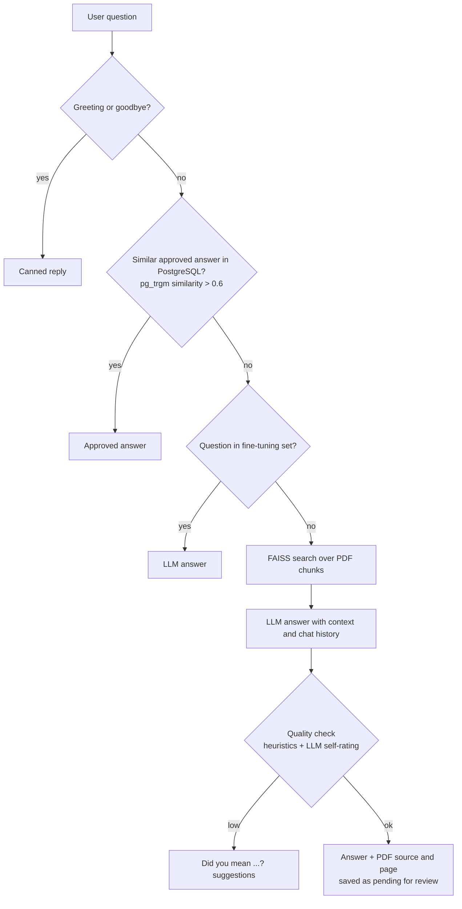

# Library Chatbot

[](https://github.com/Mehmetmrtgl/library_chatbot/actions/workflows/ci.yml)


A Turkish-language assistant for university library questions. It answers from approved Q&A pairs first, then falls back to retrieval-augmented generation over library guides (PDF), using a local LLM served by Ollama. Librarians review generated answers in an admin panel before they become part of the curated set.

## How a question is answered



## Features

- **Chat UI** with Markdown answers, autocomplete, suggested questions, like/dislike feedback and a source card that links to the PDF page the answer came from
- **Admin panel** (signed-token login): approve, edit or reject generated answers, give quality scores, request an alternative answer, browse chat history and feedback, view usage charts, export approved pairs as a fine-tuning dataset
- **Local inference only**: the LLM runs in Ollama and embeddings run on the server, so questions never leave the machine

## Tech stack

| Part | Technology |
|---|---|
| Backend | Python, Flask, SQLAlchemy, PostgreSQL (`pg_trgm`) |
| Retrieval | LangChain, FAISS, sentence-transformers (`paraphrase-multilingual-MiniLM-L12-v2`) |
| LLM | Ollama, `Qwen3-4B-Instruct-2507` (GGUF, Q8_0) via the OpenAI-compatible API |
| Frontend | React 18 (Create React App), axios, react-markdown, Recharts |

## Repository layout

```text
backend/
  app/
    app.py            Flask app factory
    auth.py           Admin login and token checks
    chat/utils.py     Answer pipeline (diagram above)
    db/models.py      SQLAlchemy models
    routes/           chat, admin, feedback, autocomplete, history, suggestions
  scripts/            Database setup, index building, model client, quality tools
  data/
    pdfs/             Source PDFs (not included, see below) served by /download
    embeddings/       FAISS indexes (RAG and autocomplete)
    finetune/         Fine-tuning and suggestion datasets
  tests/              pytest suite (runs without GPU, Ollama or a database)
  .env.example        Configuration template
frontend/
  src/components/     Chat widget and message bubbles
  src/admin/          Admin login, dashboard and panels
  src/config.js       Backend URL
start.sh              First-time setup and start
start_app.sh          Daily start
check_status.sh       Shows which services are running
```

## Setup

Requirements: Python 3.10+, Node.js 18+, PostgreSQL, and [Ollama](https://ollama.com).

1. **Model**

   ```bash
   ollama pull hf.co/unsloth/Qwen3-4B-Instruct-2507-GGUF:Q8_0
   ```

2. **Backend configuration**

   ```bash
   cp backend/.env.example backend/.env
   python -c "import secrets; print(secrets.token_hex(32))"   # paste as SECRET_KEY
   ```

   | Variable | Description |
   |---|---|
   | `DB_USER`, `DB_PASSWORD`, `DB_HOST`, `DB_PORT`, `DB_NAME` | PostgreSQL connection |
   | `SECRET_KEY` | Signs admin tokens; the backend does not start without it |
   | `ADMIN_USERNAME`, `ADMIN_PASSWORD` | Admin panel login |
   | `FLASK_DEBUG` | `1` enables the Flask debugger; keep `0` on shared networks |

3. **Start everything**

   ```bash
   ./start.sh        # first run: creates the venv, installs packages, creates the database, starts both apps
   ./start_app.sh    # later runs
   ./check_status.sh # optional: shows what is running
   ```

   The chat UI opens at http://localhost:3000 and the API listens on http://localhost:5001. To point the frontend at another backend, set `REACT_APP_API_URL` in `frontend/.env.local`.

### Manual start

```bash
# Backend
cd backend
python -m venv venv && source venv/bin/activate
pip install -r requirements.txt
(cd scripts && python create_db.py)   # creates the database, tables and pg_trgm
python -m app.app

# Frontend (second terminal)
cd frontend
npm install
npm start
```

### Source documents and indexes

The library guides used during development are copyrighted by their publishers and are not in the repository. Put your own PDFs in `backend/data/pdfs/`, then build the indexes (also needed after changing the suggestion data):

```bash
cd backend/scripts
python create_faiss_from_pdf.py        # RAG index from data/pdfs
python create_autocomplete_index.py    # autocomplete index from data/finetune/so.jsonl
```

## API

| Method | Path | Description |
|---|---|---|
| `POST` | `/chat` | Ask a question: `{ "question", "session_id", "chat_history" }` |
| `GET` | `/download/<file>` | Download a source PDF |
| `POST` | `/api/autocomplete` | Up to 5 similar questions for a prefix |
| `POST` | `/api/suggested_questions` | Follow-up suggestions |
| `POST` | `/api/feedback` | Like or dislike an answer |
| `POST` | `/admin/login` | Returns an admin token |
| | `/api/...` | Admin endpoints (review, edit, stats, history, export); require `Authorization: Bearer <token>` |

## Tests

```bash
cd backend
python -m pytest
```

The suite replaces the model, FAISS and embedding modules with stubs, so it needs no GPU, Ollama or database. CI runs it together with a production build of the frontend on every push.

## Troubleshooting

- **`similarity` function does not exist**: enable the extension with `CREATE EXTENSION pg_trgm;` in the database.
- **Chat returns a server error**: check that Ollama is running (`curl http://localhost:11434/api/tags`) and the model is pulled.
- **Backend exits with a `SECRET_KEY` error**: create `backend/.env` from `.env.example`.

## License

MIT
